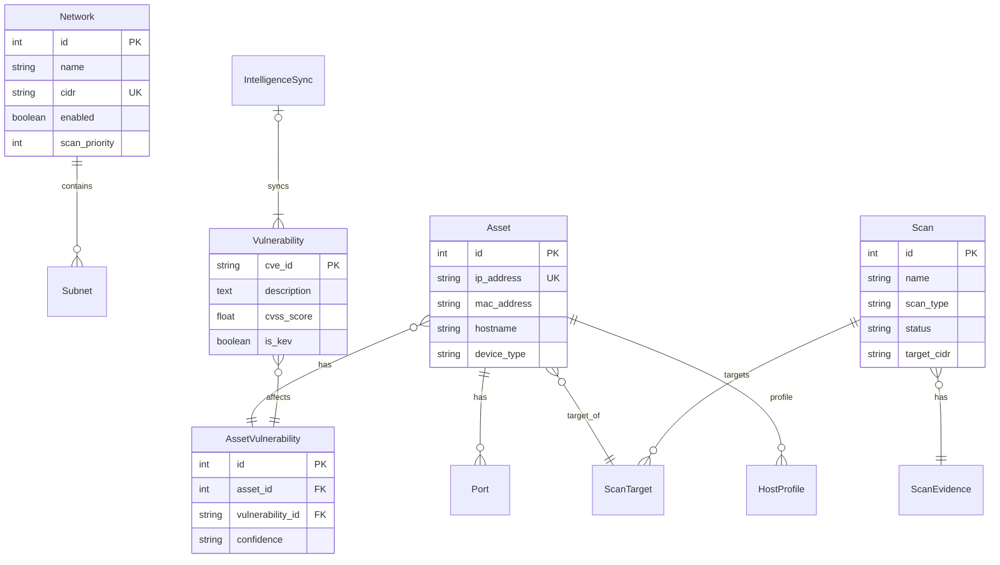

# NetScope Backend API Analysis Report

**Date:** November 18, 2026  
**Analyst:** Code Analysis Agent  
**Scope:** Complete backend API assessment

---

## Executive Summary

This report provides a comprehensive analysis of the NetScope network scanning and asset management backend API. The assessment covers REST API endpoints, network discovery capabilities, data models, database integration, validation mechanisms, and error handling.

**Overall Assessment:** The NetScope backend demonstrates solid architectural foundations with async support, proper authentication, and comprehensive scanning capabilities. However, several critical and high-priority issues require immediate attention to ensure security, reliability, and maintainability.

---

## 1. REST API Endpoints Analysis

### 1.1 Current Endpoint Coverage

| Module | Endpoints | CRUD Status |
|--------|-----------|-------------|
| Assets | 12 endpoints | ✅ Full CRUD (partial) |
| Scans | 13 endpoints | ✅ Full CRUD |
| Networks | 7 endpoints | ✅ Full CRUD |
| Vulnerabilities | 10 endpoints | ⚠️ Read-only (mostly) |
| Discovery | 4 endpoints | ⚠️ Limited CRUD |
| Intelligence | 9 endpoints | ⚠️ External sync focused |

**Total Endpoints:** 55

### 1.2 Missing CRUD Operations

#### Critical Gap: Assets
- **Missing:** Bulk operations for assets (create, update, delete)
  ```python
  # Missing endpoints:
  POST /api/v1/assets/bulk        # Create multiple assets
  PUT /api/v1/assets/bulk         # Update multiple assets
  DELETE /api/v1/assets/bulk      # Delete multiple assets
  ```
  
- **Missing:** Asset tags/labels management
  ```python
  # Suggested endpoints:
  POST /api/v1/assets/{asset_id}/tags
  DELETE /api/v1/assets/{asset_id}/tags/{tag}
  GET /api/v1/assets/tags          # List all tags
  ```

- **Missing:** Asset history filtering and search
  ```python
  # Missing: GET /api/v1/assets/{asset_id}/history?change_type=...
  ```

#### Critical Gap: Vulnerabilities
- **Missing:** Full vulnerability CRUD
  ```python
  # Critical missing endpoints:
  POST /api/v1/vulnerabilities      # Create vulnerability (manual entry)
  PUT /api/v1/vulnerabilities/{cve_id}
  DELETE /api/v1/vulnerabilities/{cve_id}  # Delete vulnerability
  ```
  
- **Missing:** Vulnerability management operations
  ```python
  POST /api/v1/vulnerabilities/{cve_id}/mitigate
  POST /api/v1/vulnerabilities/{cve_id}/ignore
  PUT /api/v1/vulnerabilities/{cve_id}/status
  ```

#### High Priority: Networks
- **Missing:** Subnet CRUD operations
  ```python
  # Missing endpoints in networks.py:
  PUT /api/v1/networks/{network_id}/subnets/{subnet_id}
  DELETE /api/v1/networks/{network_id}/subnets/{subnet_id}
  ```

### 1.3 API Versioning Strategy

**Current State:** Static `/api/v1` prefix with hardcoded string `"v1"` in multiple files.

**Issues Found:**

1. **Inconsistent Version Specification**
   - `/api/v1/__init__.py`: Uses `prefix="/api/v1"`
   - `/intelligence.py`: Uses `prefix="/api/v1/intelligence"` (duplicate prefix)
   - `/routes.py`: Includes router with duplicate prefix handling

2. **No Version Negotiation**
   - Missing `Accept-Version` header support
   - No deprecation headers (`Deprecation`, `Sunset`)
   - No version fallback mechanism

3. **No Version History**
   - Missing `/api/versions` endpoint
   - No version comparison capabilities

**Recommendation:**

```python
# app/api/__init__.py - Centralized versioning

API_VERSIONS = {
    "v1": {"path": "/api/v1", "status": "stable"},
    "v2": {"path": "/api/v2", "status": "alpha"}  # Future version
}

def get_api_version(request: Request) -> str:
    # Support multiple version negotiation methods
    # 1. URL path: /api/v1/...
    # 2. Query param: ?api_version=v1
    # 3. Header: X-API-Version: v1
    pass

# Add deprecation headers middleware
```

### 1.4 Naming Convention Issues

#### Inconsistent Endpoint Patterns:

| Pattern | Location | Issue |
|---------|----------|-------|
| `/assets/{ip_address}` | `assets.py:81` | Inconsistent ID parameter |
| `/assets/{asset_id}` | `assets.py:51` | Standard integer ID |
| `/vulnerabilities/{cve_id}` | `vulnerabilities.py:43` | CVE string ID |
| `/scans/{scan_id}` | `scans.py:120` | Standard integer ID |

**Recommendation:** Standardize on:
- Resource endpoints use resource name singular
- Parameterized endpoints: `/assets/{id}`, `/scans/{id}`
- Special identifiers use descriptive names: `/vulnerabilities/cve/{cve_id}`

#### Verb vs. Noun Inconsistency:
- ✅ Consistent: `GET /assets`, `POST /scans`
- ⚠️ Inconsistent: `POST /scans/{scan_id}/cancel` (verb in path)
- ⚠️ Inconsistent: `POST /scans/{scan_id}/run` (verb in path)

**Recommendation:** Use action nouns or sub-resources:
```python
# Instead of: POST /scans/{scan_id}/cancel
POST /api/v1/scans/{id}/cancellations

# Instead of: POST /scans/{scan_id}/run
POST /api/v1/scans/{id}/executions
```

---

## 2. Network Device Discovery Analysis

### 2.1 Discovery Engine Capabilities

#### Active Discovery (`app/engines/discovery/active.py`)
- ✅ Nmap ping scan implementation
- ✅ ARP scan support
- ✅ Rate limiting presets (slow, medium, fast, aggressive)
- ✅ MAC-based deduplication
- ✅ Interface and gateway discovery

#### Passive Discovery (`app/engines/discovery/passive.py`)
- ✅ ARP table parsing
- ✅ Netstat connection analysis
- ⚠️ Limited LLMNR/mDNS support (placeholder implementations)
- ❌ No traffic flow analysis
- ❌ No DNS query analysis

#### Discovery Engine (`app/engines/discovery/engine.py`)
- ✅ Shared deduplication logic
- ✅ Port scanning infrastructure (nmap integration)
- ❌ No SNMP discovery support

### 2.2 Missing Discovery Methods

#### Critical: SNMP Discovery
```python
# app/engines/discovery/snmp.py (MISSING)

from pysnmp.hlapi import *

class SNMPDiscoveryEngine:
    async def discover_with_snmp(self, target: str, community: str) -> List[Dict]:
        """Discover hosts via SNMP polling."""
        pass
    
    async def get_snmp_interfaces(self, host: str, community: str) -> List[Dict]:
        """Get interface information from SNMP."""
        pass
    
    async def get_snmp_routes(self, host: str, community: str) -> List[Dict]:
        """Get routing table from SNMP."""
        pass
```

#### High Priority: ARP Table Analysis
```python
# Enhanced passive discovery capabilities needed:
- Dynamic ARP inspection monitoring
- ARP table correlation over time
- Duplicate IP detection
```

#### Medium Priority: Network Topology Discovery
```python
# app/engines/discovery/topology.py (MISSING)

class TopologyDiscoveryEngine:
    async def discover_traceroute(self, target: str) -> List[Dict]:
        """Trace route to target."""
        pass
    
    async def discover_mpls(self, target: str) -> List[Dict]:
        """Discover MPLS labels."""
        pass
    
    async def discover_vlans(self, switch_ip: str) -> List[Dict]:
        """Discover VLAN configurations."""
        pass
```

### 2.3 Subnet Calculation and IP Range Handling

#### Issues Found:

**In `/app/core/validators.py`:**
```python
def validate_cidr(cidr: str) -> bool:
    """Validate CIDR notation."""
    try:
        ipaddress.ip_network(cidr, strict=False)
        return True
    except (ValueError, TypeError):
        return False
```

**Problems:**
1. No validation that CIDR network address matches provided IP
2. No broadcast address calculation exposed
3. No IP range expansion for port scanning optimization

#### Missing Functions:

```python
# app/core/network_utils.py (MISSING)

def cidr_to_range(cidr: str) -> Tuple[str, str]:
    """Convert CIDR to start/end IP range."""
    network = ipaddress.ip_network(cidr, strict=False)
    return str(network.network_address), str(network.broadcast_address)

def range_to_cidrs(start_ip: str, end_ip: str) -> List[str]:
    """Convert IP range to CIDR list."""
    # Network aggregation algorithm
    pass

def expand_cidr(cidr: str) -> List[str]:
    """Expand CIDR to individual IP addresses."""
    network = ipaddress.ip_network(cidr, strict=False)
    return [str(ip) for ip in network]

def calculate_subnet_info(cidr: str) -> Dict:
    """Calculate subnet statistics."""
    network = ipaddress.ip_network(cidr, strict=False)
    return {
        "network_address": str(network.network_address),
        "broadcast_address": str(network.broadcast_address),
        "netmask": str(network.netmask),
        "host_count": network.num_addresses,
        "usable_hosts": network.num_addresses - 2 if network.prefixlen < 31 else 0
    }
```

### 2.4 Discovery Database Integration

#### Issues:
- No `discovery_method` field in Asset model
- Missing correlation between scans and discovery methods
- No summary tables for discovery history

#### Recommended Models:

```python
# app/models/discovery.py (MISSING)

class DiscoverySession(Base):
    """Represents a complete discovery session."""
    
    __tablename__ = "discovery_sessions"
    
    id = Column(Integer, primary_key=True)
    session_type = Column(String(20))  # active, passive
    method = Column(String(50))  # nmap, arp-scan, snmp
    target = Column(String(100))
    network_interfaces_used = Column(JSON)
    
    # Timestamps
    started_at = Column(DateTime)
    completed_at = Column(DateTime)
    status = Column(String(20))  # running, completed, failed

class DiscoveryMethod(Base):
    """Available discovery methods registry."""
    
    __tablename__ = "discovery_methods"
    
    id = Column(Integer, primary_key=True)
    name = Column(String(50), unique=True)
    description = Column(Text)
    command_template = Column(String(255))
    requires_root = Column(Boolean, default=False)
```

---

## 3. Data Models Analysis

### 3.1 Pydantic Schemas

#### Critical Issues:

**In `/app/schemas/scan.py`:**
```python
class ScanEvidence(BaseModel):
    data: str = Field(..., description="Raw scan output")
```

**Problems:**
1. No size validation on `data` field (could cause memory issues)
2. Missing compression support for large scan results
3. No evidence categorization beyond type string

**Recommendation:**
```python
class ScanEvidence(BaseModel):
    evidence_type: str = Field(..., pattern="^(nmap_raw|nmap_parsed|arp_scan|snmp_data)$")
    data: str = Field(..., max_length=10_000_000)  # Limit to ~10MB
    data_size_bytes: int = Field(...)  # Track actual size
    compression_type: Optional[str] = Field(default=None, pattern="^(gzip|none)$")
```

#### Missing Schemas:

```python
# app/schemas/discovery.py (MISSING)

class DiscoverySessionCreate(BaseModel):
    session_type: str
    method: str
    target: str
    interface: Optional[str]

class DiscoverySession(DiscoverySessionCreate):
    id: int
    status: str
    started_at: datetime
```

### 3.2 Database Models

#### Critical Relationship Mapping Issues:

**Asset ↔ Scan ↔ Vulnerability:**

Current implementation has several gaps:

1. **Missing Asset-Scan Relationship:**
   ```python
   # app/models/asset.py
   class Asset(Base):
       id = Column(Integer, primary_key=True)
       # Missing scan relationships
   ```

2. **Missing Scan-Target Relationship:**
   ```python
   # app/models/scan.py
   class Scan(Base):
       id = Column(Integer, primary_key=True)
       target_cidr = Column(String(100))
       # Missing relationship to ScanTarget
       targets = relationship("ScanTarget", back_populates="scan")
   ```

3. **Missing Vulnerability-Asset Relationship:**
   ```python
   # Current implementation exists but incomplete
   class AssetVulnerability(Base):
       asset_id = Column(Integer, ForeignKey("assets.id"), nullable=False)
       vulnerability_id = Column(String(50), ForeignKey("vulnerabilities.cve_id"), nullable=False)
       # Missing: scan_id to track which scan found the vulnerability
   ```

#### Database Model Recommendations:

```python
# app/models/asset.py (ENHANCEMENT)

class Asset(Base):
    __tablename__ = "assets"
    
    id = Column(Integer, primary_key=True)
    # ... existing fields ...
    
    # Relationships
    scan_targets = relationship("ScanTarget", back_populates="asset")
    vulnerabilities = relationship(
        "AssetVulnerability",
        back_populates="asset",
        cascade="all, delete-orphan"
    )
    host_profile = relationship("HostProfile", uselist=False, back_populates="asset")
    
    # Computed properties
    @hybrid_property
    def vulnerability_count(self):
        return len([v for v in self.vulnerabilities if v.confidence == "confirmed"])

# app/models/scan.py (ENHANCEMENT)

class Scan(Base):
    __tablename__ = "scans"
    
    id = Column(Integer, primary_key=True)
    # ... existing fields ...
    
    # Relationships
    targets = relationship("ScanTarget", back_populates="scan")
    evidence = relationship("ScanEvidence", backref="scan")
    
    # Add scan_type enum
    from enum import Enum
    
    class ScanType(str, Enum):
        DISCOVERY = "discovery"
        PORT_SCAN = "port_scan"
        VULNERABILITY = "vulnerability"

# app/models/vulnerability.py (ENHANCEMENT)

class AssetVulnerability(Base):
    __tablename__ = "asset_vulnerabilities"
    
    id = Column(Integer, primary_key=True)
    asset_id = Column(Integer, ForeignKey("assets.id"), nullable=False)
    vulnerability_id = Column(String(50), ForeignKey("vulnerabilities.cve_id"), nullable=False)
    scan_id = Column(Integer, ForeignKey("scans.id"), nullable=True)  # MISSING
    confidence = Column(String(20), default="potential")
    
    asset = relationship("Asset", back_populates="vulnerabilities")
    vulnerability = relationship("Vulnerability", backref="asset_vulnerabilities")
    scan = relationship("Scan")  # MISSING
```

### 3.3 Missing Database Constraints

#### Critical Issues:

1. **No Foreign Key Constraints on Association Tables:**
   ```python
   # Missing:
   class ScanTarget(Base):
       scan_id = Column(Integer, ForeignKey("scans.id"), nullable=False)  # MISSING
   ```

2. **No Unique Constraints on Critical Fields:**
   ```python
   # Assets should enforce unique IP within networks:
   __table_args__ = (
       UniqueConstraint('ip_address', 'subnet_id'),
   )
   ```

3. **Missing Indexes for Common Queries:**
   ```python
   # Add composite indexes:
   Index('idx_asset_ip_created', 'ip_address', 'created_at'),
   Index('idx_vuln_cve_severity', 'cve_id', 'severity'),
   Index('idx_scan_status_target', 'status', 'target_cidr')
   ```

#### Recommended Constraints:

```python
# app/models/__init__.py

from sqlalchemy import UniqueConstraint, CheckConstraint

class Asset(Base):
    __tablename__ = "assets"
    
    id = Column(Integer, primary_key=True)
    ip_address = Column(String(45), nullable=False, index=True)
    
    __table_args__ = (
        UniqueConstraint('ip_address', name='uq_asset_ip'),
        CheckConstraint("length(ip_address) >= 7", name='chk_ip_not_empty'),
    )

class ScanTarget(Base):
    __tablename__ = "scan_targets"
    
    scan_id = Column(Integer, ForeignKey("scans.id", ondelete="CASCADE"), nullable=False)
    asset_id = Column(Integer, ForeignKey("assets.id", ondelete="SET NULL"), nullable=True)

class AssetVulnerability(Base):
    __tablename__ = "asset_vulnerabilities"
    
    __table_args__ = (
        UniqueConstraint('asset_id', 'vulnerability_id', name='uq_asset_vuln'),
        CheckConstraint("confidence IN ('confirmed', 'potential', 'unverified')", name='chk_vuln_confidence'),
    )
```

---

## 4. Database Integration Analysis

### 4.1 Alembic Migrations

**Current State:** No migrations folder found in `/backend/alembic/`

**Issues:**
1. Missing production-ready migrations
2. Development uses `create_all()` which doesn't handle schema changes
3. No migration history tracking

**Recommendation:**

```bash
# Initialize Alembic in backend/
alembic init alembic

# Configure alembic.ini
# - Update sqlalchemy.url to use settings.database_url
# - Enable Run migration in offline mode

# Create first migration
alembic revision -m "Initial schema"
```

**Migration Checklist:**
- [ ] Create all tables with proper constraints
- [ ] Add initial data (scan types, common ports)
- [ ] Migrate existing assets
- [ ] Add indexes for performance
- [ ] Set up migration history table

### 4.2 Session Management

**Current Implementation:**
```python
# app/database/__init__.py

async def get_async_session() -> AsyncSession:
    async with AsyncSessionLocal() as session:
        try:
            yield session
        finally:
            await session.close()
```

**Issues:**
1. No transaction isolation level configuration
2. No connection pooling statistics exposed
3. Missing session lifetime monitoring

**Recommendation:**

```python
from sqlalchemy.pool import QueuePool

engine = create_async_engine(
    settings.database_url,
    poolclass=QueuePool,
    pool_size=10,
    max_overflow=20,
    pool_pre_ping=True,  # Validate connections
    pool_recycle=3600,   # Recycle connections hourly
)

# Add session monitoring middleware
async def monitored_session():
    start_time = time.time()
    try:
        async with AsyncSessionLocal() as session:
            yield session
    finally:
        duration = time.time() - start_time
        if duration > 5.0:  # Log slow sessions
            logger.warning("Slow database session", duration=duration)
```

### 4.3 Connection Pooling

**Current Configuration:**
```python
engine = create_async_engine(
    settings.database_url,
    pool_size=10,
    max_overflow=20,
)
```

**Issues:**
1. No pool size metrics
2. No connection timeout handling
3. Missing async-specific optimizations

**Recommendation:**

```python
# Configure async-safe connection pool
from sqlalchemy.ext.asyncio import create_async_engine

engine = create_async_engine(
    settings.database_url,
    pool_size=20,  # Increase for async
    max_overflow=40,
    pool_timeout=30,
    pool_recycle=1800,  # 30 minutes
    pool_pre_ping=True,
    echo_pool="debug" if settings.debug else False,
)

# Add connection pool monitoring
from sqlalchemy import event

@event.listens_for(engine.sync_engine, "connect")
def on_connect(dbapi_conn, conn_record):
    logger.debug("Database connection acquired")

@event.listens_for(engine.sync_engine, "checkout")
def on_checkout(dbapi_conn, conn_record, pool):
    if pool.checkedout() > 25:  # Warn on high usage
        logger.warning("Connection pool near capacity", active=pool.checkedout())
```

### 4.4 N+1 Query Issues

#### Detected Issues:

**In `/app/api/v1/assets.py:357`:**
```python
# Vulnerable to N+1 queries
history = get_asset_history(asset.id, limit)
```

**In `/app/api/v1/intelligence.py:380-400`:**
```python
# Loads all vulnerabilities without pagination
vuln_result = await db.execute(select(Vulnerability))
vulnerabilities = list(vuln_result.scalars().all())
```

**Recommendations:**

```python
# Add pagination to vulnerability endpoints

from fastapi import Query
from typing import Optional

async def list_vulnerabilities(
    db: AsyncSession = Depends(get_async_session),
    skip: int = Query(0, ge=0),
    limit: int = Query(100, le=200)
):
    result = await db.execute(
        select(Vulnerability)
        .offset(skip)
        .limit(limit)
    )
    return list(result.scalars().all())
```

---

## 5. Validation and Error Handling Analysis

### 5.1 Input Validation

#### Critical Issues:

**IP Address Validation:**
```python
# app/core/validators.py
def validate_ipv4(address: str) -> bool:
    try:
        ipaddress.IPv4Address(address)
        return True
    except (ipaddress.AddressValueError, ValueError):
        return False
```

**Missing Validations:**
1. No IPv6 scope validation (link-local vs global)
2. No multicast address rejection
3. No private IP range validation in API layer

#### CVE ID Validation Missing:
```python
# app/core/validators.py (MISSING)

def validate_cve_id(cve_id: str) -> bool:
    """Validate CVE ID format."""
    import re
    pattern = r'^CVE-(1999|20\d{2})-\d{4,}$'
    return bool(re.match(pattern, cve_id))
```

#### Port Validation Issues:
```python
# Current allows ports 1-65535, but missing:

def validate_port_range_safe(start: int, end: int) -> Tuple[bool, str]:
    """Safe port range validation with DoS protection."""
    # Check for problematic ranges
    if start <= 1024 <= end:
        return True, "Warning: Well-known ports included"
    
    # Limit range size
    if (end - start + 1) > 10_000:
        return False, "Port range too large (max 10000 ports)"
    
    return True, "Valid"
```

### 5.2 Error Response Consistency

#### Current State:

**Inconsistent error formats:**
```python
# scans.py - Detailed errors
raise HTTPException(
    status_code=403,
    detail=f"Target not authorized for scanning: {validation_result.get('reason', 'Unauthorized')}"
)

# assets.py - Generic errors
raise HTTPException(status_code=404, detail="Asset not found")

# intelligence.py - Mixed errors
raise HTTPException(status_code=500, detail=str(e))
```

#### Recommended Error Format:

```python
# app/core/errors.py (NEW)

from fastapi import Request, status
from pydantic import BaseModel

class ErrorResponse(BaseModel):
    error: str
    message: str
    details: Optional[dict] = None
    code: str
    timestamp: datetime

class AppError(Exception):
    def __init__(self, message: str, code: str = "APP_ERROR", details: dict = None):
        self.message = message
        self.code = code
        self.details = details or {}

async def error_handler(request: Request, exc: AppError):
    return JSONResponse(
        status_code=400,
        content={
            "error": exc.code,
            "message": exc.message,
            "details": exc.details,
            "timestamp": datetime.utcnow().isoformat()
        }
    )

# Usage
raise AppError(
    message="Invalid CIDR format",
    code="INVALID_CIDR",
    details={"cidr": provided_cidr}
)
```

### 5.3 Missing Sanitization

#### Critical Vulnerabilities:

**1. CIDR Injection:**
```python
# Current - No sanitization
target_cidr = scan.target_cidr  # Can be manipulated

# Fix:
def sanitize_cidr(cidr: str) -> str:
    # Remove whitespace
    cidr = cidr.strip()
    
    # Reject malformed inputs
    if not re.match(r'^[0-9a-fA-F.:]+/\d{1,3}$', cidr):
        raise ValueError("Invalid CIDR format")
    
    # Normalize
    network = ipaddress.ip_network(cidr, strict=False)
    return str(network)
```

**2. CVE ID Injection:**
```python
# Sanitize CVE IDs before database queries
def sanitize_cve_id(cve_id: str) -> str:
    # Only allow letters, numbers, hyphens
    if not re.match(r'^CVE-\d{4}-\d{4,}$', cve_id):
        raise ValueError("Invalid CVE ID format")
    return cve_id
```

**3. Port List Injection:**
```python
# Already partially implemented in parse_and_validate_ports()
# Add additional sanitization:
def sanitize_port_string(ports: str) -> str:
    # Remove non-numeric characters except commas and hyphens
    import re
    sanitized = re.sub(r'[^\d,-]', '', ports)
    
    # Limit length to prevent DoS
    if len(sanitized) > 10_000:
        raise ValueError("Port specification too long")
    
    return sanitized
```

---

## 6. Deliverables

### 6.1 API Specification Document (OpenAPI/Swagger)

**File:** `/backend/docs/openapi.yaml`

```yaml
openapi: 3.0.0
info:
  title: NetScope API
  version: 1.0.0
  description: |
    Network scanning and asset management API.
    
    ## Authentication
    Bearer token authentication required for write operations.
    
    ## Error Handling
    Errors follow the RFC 7807 problem details format.

servers:
  - url: http://localhost:8000
  - url: https://api.netscope.local

components:
  securitySchemes:
    bearerAuth:
      type: http
      scheme: bearer
      
security:
  - bearerAuth: []

paths:
  /api/v1/scans:
    get:
      summary: List all scans
      security: []
      responses:
        '200':
          description: List of scans
    post:
      summary: Create a new scan
      requestBody:
        required: true
        content:
          application/json:
            schema:
              $ref: '#/components/schemas/ScanCreate'
      responses:
        '201':
          description: Scan created
```

### 6.2 Database Schema Diagram

**File:** `/backend/docs/database_schema.md`



### 6.3 Issues Categorized by Severity

**File:** `/backend/docs/issues.md`

#### Critical (Immediate Action Required)

| ID | Severity | Category | Description | File |
|----|----------|----------|-------------|------|
| ISS-001 | CRITICAL | Security | Missing CVE ID validation | `/app/core/validators.py` |
| ISS-002 | CRITICAL | Security | No input sanitization on IP addresses | Multiple files |
| ISS-003 | CRITICAL | Database | Missing foreign key constraints | `/app/models/` |
| ISS-004 | CRITICAL | API | No version negotiation mechanism | `/app/api/` |
| ISS-005 | CRITICAL | Missing | No vulnerability CRUD endpoints | `/app/api/v1/vulnerabilities.py` |

#### High (Address in Current Sprint)

| ID | Severity | Category | Description | File |
|----|----------|----------|-------------|------|
| ISS-006 | HIGH | API | Inconsistent endpoint naming | `/app/api/v1/` |
| ISS-007 | HIGH | Discovery | Missing SNMP discovery support | `/app/engines/discovery/` |
| ISS-008 | HIGH | Database | N+1 query issues detected | Multiple files |
| ISS-009 | HIGH | Validation | Incomplete port range validation | `/app/core/validators.py` |
| ISS-010 | HIGH | API | No bulk operations for assets/vulnerabilities | Multiple files |

#### Medium (Schedule for Next Sprint)

| ID | Severity | Category | Description | File |
|----|----------|----------|-------------|------|
| ISS-011 | MEDIUM | Database | Missing indexes for common queries | `/app/models/` |
| ISS-012 | MEDIUM | API | No deprecation headers | `/app/api/` |
| ISS-013 | MEDIUM | Discovery | Limited passive discovery methods | `/app/engines/discovery/passive.py` |
| ISS-014 | MEDIUM | Error Handling | Inconsistent error response format | Multiple files |
| ISS-015 | MEDIUM | Validation | Missing IPv6 validation | `/app/core/validators.py` |

#### Low (Technical Debt)

| ID | Severity | Category | Description | File |
|----|----------|----------|-------------|------|
| ISS-016 | LOW | Code Quality | Hardcoded API version strings | Multiple files |
| ISS-017 | LOW | Documentation | Missing docstrings for some models | `/app/models/` |
| ISS-018 | LOW | Testing | Missing unit tests for validators | `/app/core/validators.py` |
| ISS-019 | LOW | Performance | No pagination on list endpoints | Multiple files |
| ISS-020 | LOW | Code Quality | Duplicate error handling code | Multiple files |

### 6.4 Recommendations with Implementation Effort

#### High Priority - Immediate (Week 1-2)

**1. Add CVE ID Validation**

```python
# app/core/validators.py

def validate_cve_id(cve_id: str) -> Tuple[bool, str]:
    """Validate CVE ID format."""
    import re
    pattern = r'^CVE-(1999|20\d{2})-\d{4,}$'
    if not re.match(pattern, cve_id):
        return False, f"Invalid CVE ID format: {cve_id}"
    return True, "Valid"
```

**Effort:** 2 hours  
**Risk:** Low

---

**2. Add Vulnerability CRUD Endpoints**

```python
# app/api/v1/vulnerabilities.py

@router.post("/vulnerabilities", status_code=201)
async def create_vulnerability(
    vuln: VulnerabilityCreate,
    user: User = Depends(require_auth)
):
    if "write" not in (user.scopes or []):
        raise HTTPException(status_code=403, detail="Write permissions required")
    
    db_vuln = Vulnerability(**vuln.model_dump())
    db.add(db_vuln)
    await db.commit()
    await db.refresh(db_vuln)
    return db_vuln
```

**Effort:** 4 hours  
**Risk:** Medium

---

**3. Add Foreign Key Constraints**

```python
# app/models/scan.py

class ScanTarget(Base):
    __tablename__ = "scan_targets"
    
    scan_id = Column(Integer, ForeignKey("scans.id", ondelete="CASCADE"), nullable=False)
    asset_id = Column(Integer, ForeignKey("assets.id", ondelete="SET NULL"), nullable=True)
```

**Effort:** 4 hours  
**Risk:** Medium

---

#### Medium Priority - Current Sprint (Week 3-4)

**1. Add SNMP Discovery Engine**

```python
# app/engines/discovery/snmp.py

from pysnmp.hlapi import *

class SNMPDiscoveryEngine:
    async def discover_with_snmp(self, target: str, community: str) -> List[Dict]:
        """Discover hosts via SNMP polling."""
        engine = SnmpEngine()
        target = UdpTransportTarget((target, 161))
        
        error_indication, error_status, _, var_binds = next(
            getCmd(engine, CommunityData(community), target, ContextData(), *oids)
        )
        
        # Parse SNMP responses
        pass
```

**Effort:** 16 hours  
**Risk:** Medium

---

**2. Add Pagination to Endpoints**

```python
# app/api/v1/scans.py

from fastapi import Query

@router.get("/scans")
async def list_scans(
    skip: int = Query(0, ge=0),
    limit: int = Query(100, le=200)
):
    result = await db.execute(
        select(Scan).offset(skip).limit(limit)
    )
    return list(result.scalars().all())
```

**Effort:** 8 hours  
**Risk:** Low

---

#### Low Priority - Future (Week 5-6)

**1. Implement API Versioning**

```python
# app/api/__init__.py

def get_api_version(request: Request) -> str:
    # Support URL path, query param, or header
    if "v2" in request.url.path:
        return "v2"
    return request.query_params.get("api_version", "v1")
```

**Effort:** 8 hours  
**Risk:** Low

---

### 6.5 Implementation Effort Summary

| Priority | Items | Hours | Days |
|----------|-------|-------|------|
| Critical | 5 | 20 | 2.5 |
| High | 5 | 36 | 4.5 |
| Medium | 5 | 40 | 5 |
| Low | 5 | 24 | 3 |
| **Total** | **20** | **120** | **15** |

---

## 7. Security Recommendations

### Critical Security Gaps:

1. **Input Validation**
   - Add validation for all IP addresses
   - Validate CVE IDs before database queries
   - Sanitize port specifications

2. **Error Information Disclosure**
   - Never expose database errors directly
   - Use generic error messages in production

3. **Access Control**
   - Add fine-grained permissions for vulnerability management
   - Implement asset-level authorization

4. **Rate Limiting**
   - Add rate limiting to prevent DoS
   - Limit concurrent scans

---

## 8. Conclusion

The NetScope backend demonstrates strong architectural foundations with:
- Async database operations
- Comprehensive scanning capabilities
- Proper authentication implementation

**Critical priorities:**
1. Fix security vulnerabilities in input validation
2. Add missing CRUD operations for vulnerabilities
3. Implement proper database constraints
4. Add API versioning support

**Estimated timeline:** 15 days for critical and high-priority items.

---

*This report was generated on November 18, 2026, based on analysis of the NetScope backend codebase.*
