# NetScope Database Schema Diagram

## Entity Relationship Diagram

```mermaid
erDiagram
    %% Main Entities
    Network ||--o{ Subnet : "contains"
    Asset ||--o{ Port : "has_scanned_ports"
    Asset ||--o{ ScanTarget : "is_target_of"
    Asset }o--|| ScanTarget : "targeted_by_scan"
    
    %% Scanning Relationships
    Scan ||--o{ ScanTarget : "has_targets"
    Scan }o--|| ScanEvidence : "preserves_evidence"
    
    %% Asset Details
    Asset ||--o{ HostProfile : "has_profile"
    Asset ||--o{ AssetHistory : "has_history"
    Asset }o--|| AssetVulnerability : "affected_by_vulnerabilities"
    
    %% Vulnerability Relationships
    Vulnerability }o--|| AssetVulnerability : "affects_assets"
    Vulnerability }o--|| VulnerabilityProduct : "has_products"
    
    %% Intelligence Tracking
    IntelligenceSync o|--|{ Vulnerability : "syncs_vulnerabilities"
    
    %% Risk Assessment
    RiskFinding }o--|| Asset : "applies_to_asset"
    RiskFinding }o--|| Vulnerability : "assesses_vulnerability"

    %% Tables
    
    Network {
        int id PK "Primary Key"
        string name "Network name"
        string cidr UK "Network CIDR (unique)"
        text description "Optional description"
        boolean enabled "Enable scanning"
        int scan_priority "Priority (higher = more urgent)"
        string rate_limit "Scan speed preset"
        datetime created_at
    }
    
    Subnet {
        int id PK "Primary Key"
        string name "Subnet name"
        string cidr "Subnet CIDR"
        int network_id FK "Reference to Network"
        datetime created_at
    }
    
    Asset {
        int id PK "Primary Key"
        string ip_address UK "IP address (unique)"
        string mac_address "MAC address"
        string hostname "Device hostname"
        string device_type "Type of device (router, server, etc.)"
        string operating_system "Detected OS"
        string os_version "OS version"
        string vendor "Hardware vendor"
        string confidence_level "Discovery confidence"
        datetime created_at
        datetime updated_at
    }
    
    NetworkInterface {
        int id PK "Primary Key"
        string name "Interface name (eth0, enp0s3)"
        string mac_address UK "MAC address"
        string ip_address "IP address"
        string netmask "Subnet mask"
        string gateway "Default gateway"
        string interface_type "ethernet, wifi, etc."
        datetime created_at
    }
    
    Port {
        int id PK "Primary Key"
        int port_number "Port number (1-65535)"
        string protocol "tcp or udp"
        string state "open, closed, filtered"
        string service_name "Service name (ssh, http)"
        string product "Product name"
        string version "Version string"
        text banner "Service banner"
        string confidence_level "Scan confidence"
        datetime created_at
    }
    
    Scan {
        int id PK "Primary Key"
        string name "Scan description"
        string scan_type "discovery, port_scan, vulnerability"
        string status "pending, running, completed, cancelled, failed"
        int progress "0-100%"
        string target_cidr "Target network CIDR"
        string rate_limit "Scan speed preset"
        text ports "Port specification (JSON)"
        datetime started_at
        datetime completed_at
        int hosts_found
        int ports_found
        int services_found
        datetime created_at
        datetime updated_at
    }
    
    ScanTarget {
        int id PK "Primary Key"
        int scan_id FK "Reference to Scan"
        string ip_address "Target IP address"
        string hostname "Target hostname"
        string status "pending, scanning, completed, failed"
        int progress "0-100%"
        datetime started_at
        datetime completed_at
        datetime created_at
    }
    
    ScanEvidence {
        int id PK "Primary Key"
        int scan_id FK "Reference to Scan"
        string evidence_type "nmap_raw, nmap_parsed, arp_scan, snmp_data"
        text data "Raw scan output or JSON results"
        text evidence_metadata "Additional metadata (JSON)"
        datetime created_at
    }
    
    AssetHistory {
        int id PK "Primary Key"
        int asset_id FK "Reference to Asset"
        string change_type "os_update, port_change, vulnerability_found, etc."
        json changed_fields "List of changed field names"
        json old_values "Previous values"
        json new_values "New values"
        int scan_id FK "Optional reference to Scan that triggered change"
        string performed_by "User or system identifier"
        text description "Human-readable description"
        string severity "critical, high, medium, low"
        datetime created_at
    }
    
    AssetVulnerability {
        int id PK "Primary Key"
        int asset_id FK "Reference to Asset"
        string vulnerability_id FK "Reference to Vulnerability (CVE ID)"
        string confidence "confirmed, potential, unverified"
        text evidence "Evidence of vulnerability"
        int scan_id FK "Reference to Scan that discovered vulnerability"
        datetime created_at
    }
    
    Vulnerability {
        string cve_id PK "CVE identifier (e.g., CVE-2024-1234)"
        text description "Vulnerability description"
        float cvss_score "CVSS score (0-10)"
        string cvss_version "2.0 or 3.1"
        string severity "critical, high, medium, low, info"
        boolean is_kev "Known Exploited Vulnerability"
        float epss_score "EPSS probability score"
        float epss_percentile "EPSS percentile"
        datetime published_date
        datetime last_modified_date
        text references "JSON array of reference URLs"
        datetime created_at
        datetime updated_at
    }
    
    VulnerabilityProduct {
        int id PK "Primary Key"
        string vulnerability_id FK "Reference to Vulnerability"
        text cpe_match "CPE matching string"
        string affected_versions "Affected version range"
        string patched_versions "Patched version range"
        datetime created_at
    }
    
    IntelligenceSync {
        int id PK "Primary Key"
        string source_name UK "cisa_kev, nvd, epss"
        datetime last_sync
        string sync_status "pending, success, failed"
        int records_count "Number of records synced"
        datetime created_at
    }
    
    RiskFinding {
        int id PK "Primary Key"
        int asset_id FK "Reference to Asset"
        string vulnerability_id FK "Reference to Vulnerability"
        string cvss_severity "Critical, High, Medium, Low, Info"
        string kev_status "kev, not_kev"
        float epss_score
        int risk_score "0-100 calculated risk score"
        string priority "critical, high, medium, low"
        string match_confidence "confirmed, potential, unverified"
        text evidence "Evidence of risk finding"
        datetime first_seen
        datetime last_assessed
    }
```



## Database Indexes

### Critical Performance Indexes

```python
# app/models/asset.py
Index('idx_asset_ip_created', 'ip_address', 'created_at')
Index('idx_asset_mac', 'mac_address')

# app/models/scan.py
Index('idx_scan_status_target', 'status', 'target_cidr')
Index('idx_scan_created', 'created_at')

# app/models/vulnerability.py
Index('idx_vuln_cve_severity', 'cve_id', 'severity')
Index('idx_vuln_kev', 'is_kev')

# app/models/asset_history.py
Index('idx_history_asset_type', 'asset_id', 'change_type')
```

## Foreign Key Constraints

```python
# Constraint definitions
AssetVulnerability.asset_id → Asset.id (ON DELETE CASCADE)
AssetVulnerability.vulnerability_id → Vulnerability.cve_id (ON DELETE CASCADE)
AssetVulnerability.scan_id → Scan.id (ON DELETE SET NULL)

ScanTarget.asset_id → Asset.id (ON DELETE SET NULL)
ScanTarget.scan_id → Scan.id (ON DELETE CASCADE)

AssetHistory.asset_id → Asset.id (ON DELETE CASCADE)
AssetHistory.scan_id → Scan.id (ON DELETE SET NULL)

RiskFinding.asset_id → Asset.id (ON DELETE CASCADE)
RiskFinding.vulnerability_id → Vulnerability.cve_id (ON DELETE CASCADE)

HostProfile.asset_id → Asset.id (ON DELETE CASCADE)
```

## Database Statistics

### Estimated Record Counts

| Table | Estimated Records | Notes |
|-------|------------------|-------|
| assets | 1,000 - 100,000+ | Depends on network size |
| scans | 100 - 1,000+ | Monthly scan frequency |
| vulnerabilities | ~200,000 | Full NVD database |
| port | 1,000 - 1,000,000+ | Per-asset port scans |
| host_profiles | 1,000 - 100,000+ | One per asset |
| intelligence_syncs | <10 | Per-source sync tracking |

### Recommended Database Configuration

```python
# For production deployment
DATABASE_CONFIG = {
    "pool_size": 20,           # Connection pool size
    "max_overflow": 40,        # Maximum overflow connections
    "pool_timeout": 30,        # Connection timeout in seconds
    "pool_recycle": 1800,      # Recycle connections every 30 minutes
    "pool_pre_ping": True,     # Validate connections before use
}
```

---

*Database schema documentation for NetScope API v1*
